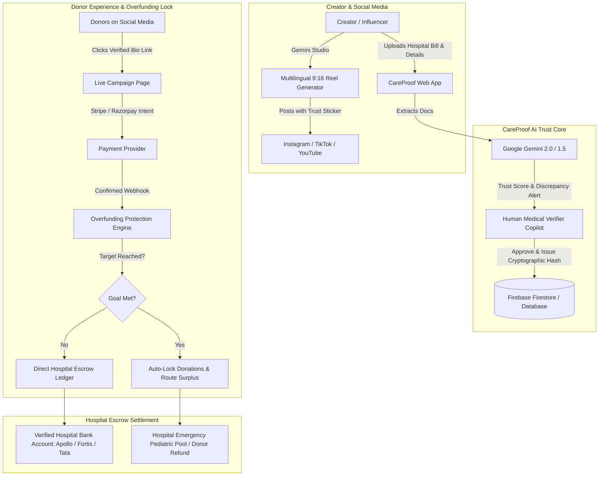

# 🏥 CareProof AI — Transparent Social Media Fundraising
> **Google H2S Hackathon Prototype** | Developed by **The 404 Brigade**  
> *Verify. Track. Escrow. Overfunding-Proof.*

---

## 🌟 1. Executive Summary & Problem Statement

### The Problem
Patients and charities increasingly turn to social media (Instagram Reels, TikTok, YouTube Shorts, X) to raise funds for urgent medical treatments. However, current platforms and viral posts suffer from critical trust and accountability failures:
1. **Unverifiable Claims & Forged Invoices:** Anyone can post a heartbreaking photo with fabricated bills, fake medical estimates, or inflated fundraising targets.
2. **Creator Wallet Diversion (Misuse):** Donations typically route directly into the influencer’s or creator’s personal UPI, PayPal, or bank account. Donors have zero visibility into whether the funds ever reach the hospital.
3. **No Real-Time Accounting:** Donors cannot track confirmed collections versus remaining hospital bills.
4. **The "Overfunding Trap":** When a social campaign goes viral, it often continues collecting tens or hundreds of thousands of dollars long after the hospital bill is completely paid, with zero accountability for surplus funds.

### The Solution: CareProof AI
**CareProof AI** bridges social media campaigns with transparent, verifiable donation tracking:
- 🛡️ **AI Campaign Verification:** Google Gemini cross-examines hospital quotations, doctor credentials, and patient diagnosis before a campaign goes live. A human-in-the-loop medical reviewer approves the final verification.
- 🏥 **Prevent Misuse (Direct Hospital Escrow):** Donated funds **never** touch the creator’s or influencer’s personal account. 100% of proceeds route directly to the verified hospital's billing escrow account.
- ⚡ **Real-Time Tracking:** Payment provider APIs update confirmed donations, displaying amount collected, target achieved, and exact remaining requirement.
- 🔒 **Automated Overfunding Protection:** The donation engine automatically locks down the second the target bill is reached, reconciles pending transactions, and applies a clearly disclosed surplus policy.
- ✨ **AI-Powered Content Engine:** Google Gemini generates multilingual 9:16 vertical Reel scripts, transparent captions, accessible plain-language medical stories, and flags inconsistencies in creator drafts.

---

## 🏗️ 2. System Architecture & Tech Stack



### Technologies Used
| Technology | Role in CareProof AI |
| :--- | :--- |
| **Google Gemini (2.0 Flash / 1.5)** | Document verification, discrepancy detection, multilingual Reel script generation (English, Hindi, Spanish, Tamil, Bengali, Marathi), social captions, and accessible story translation. |
| **Firebase / Firestore** | Real-time campaign tracking, donation ledger records, hospital escrow credentials, and security rules. |
| **Google Cloud Run** | Containerized serverless deployment (`Dockerfile` & `cloudbuild.yaml`) providing stateless scale-to-zero and high concurrency. |
| **FastAPI (Python 3.11)** | Asynchronous high-throughput backend services, WebSockets/SSE-ready endpoints, and Jinja2 templates. |
| **Tailwind CSS & Glassmorphism** | Responsive, mobile-first donor experience and creator studio with live interactive Reel phone simulator. |
| **Stripe / Razorpay APIs** | Payment intents, webhooks, and simulated real-time donation routing. |

---

## 🚀 3. Quick Start & Local Run

### Prerequisites
- Python 3.11+
- Virtual environment (optional)

### 1. Installation
```bash
cd careproof-ai
pip install -r requirements.txt
```

### 2. Configure Environment
```bash
cp .env.example .env
# Edit .env to supply your GEMINI_API_KEY (optional, realistic fallback built-in)
```

### 3. Start the Server
```bash
python3 run.py
```
Visit **http://localhost:8080** in your browser!

### 4. Run the Automated Integration Test Suite
```bash
python3 test_suite.py
```
> Tests all 12 key features: Health check, campaigns listing, hospital escrow settlement, normal donation, overfunding protection auto-lock, subsequent donation rejection, human audit review, Gemini multilingual Reels, captions, and draft inconsistency detection.

---

## 🎯 4. Guided Hackathon Demonstration Walkthrough

Follow these steps to experience all 8 hackathon requirements in action:

### Step 1: Discover Verified Campaigns (`/`)
1. Open `http://localhost:8080`.
2. Inspect the **Live Campaign Discovery** grid:
   - **Rohan Verma (6y - Apollo Hospital):** Active campaign, $19,450 raised of $22,000 target.
   - **Ananya Roy (9y - Tata Memorial):** Target Reached ($15,000), demonstrates Overfunding Protection locked.
   - **Vikram Singh (Fortis Healthcare):** Inconsistency Flagged by Gemini (Claimed $35,000 vs $18,500 Quote).

### Step 2: Test Real-Time Donation & Overfunding Protection (`/campaign/cmp_rohan_heart`)
1. Click on **Rohan Verma's Campaign**.
2. Notice the **Direct Escrow Routing Diagram**:
   `Donor Card ➡️ CareProof Escrow ➡️ Apollo Hospital Account #ESCROW-APOLLO-984210`.
3. Click **Fulfill Bill** or enter a custom amount (e.g. $100). Click **Donate Directly to Apollo Escrow**.
   - Notice the live progress bar updates instantly without page reload.
   - A cryptographic receipt hash (`CP-REC-...`) is generated.
4. **Trigger Overfunding Protection:** Click the amber button **"Test Overfunding Protection (Trigger Cap)"**.
   - The remaining amount + $500 is donated.
   - The campaign dynamically switches to **TARGET_REACHED**.
   - The donate button locks down immediately with an amber banner: *"Target Reached — Overfunding Protection Active. Excess funds routed to Hospital Emergency Pediatric Pool per disclosed policy."*
   - Try donating again: The backend strictly rejects the transaction!

### Step 3: Experience the Gemini Creator Studio (`/creator-studio`)
1. Click **Gemini Reel Studio** in the navigation bar.
2. Select language (e.g., **Hindi (हिंदी)** or **Spanish (Español)**).
3. Click **Generate with Gemini**:
   - Generates a 40-second vertical 9:16 script with scene breakdowns, camera visual prompts, spoken voiceover, and on-screen text cues.
   - The **Interactive Smartphone Simulator** displays the Reel with the holographic **CareProof Verified Trust Badge**.
4. Click the **Post Discrepancy Auditor** tab:
   - Paste a draft post containing: *"Send donations to my personal PayPal/UPI! We need $50,000 urgently in 2 hours!"*
   - Click **Audit Draft with Gemini Copilot**:
   - Gemini flags:
     * 🚨 *Critical: Directs donors to a personal account instead of hospital escrow.*
     * 🚨 *Inconsistency: Claimed $50,000 does not match verified bill of $22,000.*
     * 🚨 *High Risk: Extreme urgency claims without clinical emergency order.*

### Step 4: Human-in-the-Loop Verifier Dashboard (`/verifier`)
1. Click **Verifier Copilot** in the navigation bar.
2. View **Vikram Singh's** pending campaign:
   - Gemini flags: *Discrepancy of $16,500 (+89%) between requested target ($35,000) and Fortis quote ($18,500).*
   - AI Trust Score is reduced to 48/100.
3. Reviewer enters notes and clicks **Approve & Issue Hash**, **Flag Docs**, or **Reject**.

### Step 5: Hospital Escrow & Direct Settlement Ledger (`/hospital-escrow`)
1. Click **Hospital Escrow Ledger** in the navigation bar.
2. Inspect the banking credentials:
   - **Apollo Hospitals Bannerghatta:** Escrow Account #ESCROW-APOLLO-984210.
   - **Creator Wallet Access:** Strictly **BLOCKED (0.00%)**.
   - View the table of direct settlement transactions with transaction hashes.

---

## ☁️ 5. Google Cloud Run Deployment

CareProof AI is built to run effortlessly on Google Cloud Run:

```bash
# Deploy to Google Cloud Run via gcloud CLI
gcloud run deploy careproof-ai \
  --source . \
  --region us-central1 \
  --allow-unauthenticated \
  --set-env-vars GEMINI_API_KEY="YOUR_KEY"
```

Or trigger automated CI/CD using Cloud Build:
```bash
gcloud builds submit --config cloudbuild.yaml .
```

---

## 👥 The 404 Brigade — Google H2S Hackathon
- **Mission:** Rebuilding donor trust in social media philanthropy through transparency, AI verification, and escrow guarantees.
- **Goal:** Ensure every single dollar donated reaches the verified hospital patient care ledger.
