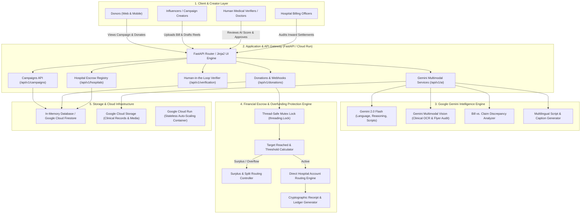
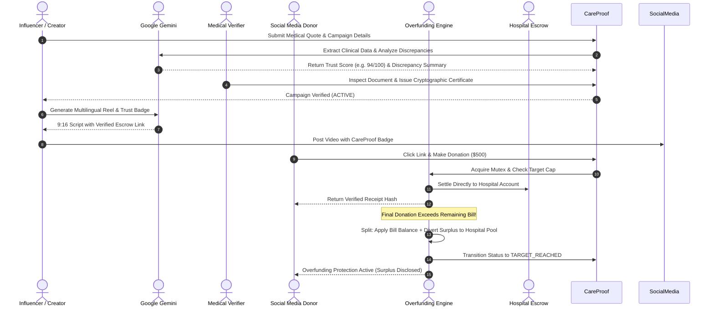

# 🩺 CareProof AI — Complete System Documentation & Architecture Whitepaper
**Google H2S (Hack2Skill) Hackathon | Team: The 404 Brigade**  
*Transparent, AI-Assisted Medical Crowdfunding Connected to Verified Hospital Escrow & Overfunding Protection*

---

## 📌 Executive Summary

Social media is the world's most powerful amplifier for emergency medical fundraising. When a child falls critically ill, a short video or Instagram Story can raise millions of dollars in a matter of days. However, the current medical crowdfunding ecosystem suffers from three fatal systemic vulnerabilities:

1. **Information Asymmetry & Fraud:** Donors cannot verify whether clinical estimates, hospital admission letters, or doctor diagnoses are authentic, tampered with, or exaggerated.
2. **Creator Wallet Diversion:** Donated funds flow directly into personal creator bank accounts, PayPal, Venmo, or private UPI handles rather than directly to the hospital billing department, creating severe risk of misappropriation.
3. **Overfunding Black Holes:** Due to algorithmic virality, campaigns frequently raise 200% to 500% over the required treatment bill with zero real-time caps, leaving unspent millions unaccounted for with no refund or surplus redistribution policy.

**CareProof AI** solves this trifecta by introducing a real-time, AI-supervised verification and escrow infrastructure:
- **Multimodal AI Verification (Google Gemini 2.0 / 1.5):** Scans clinical quotes, bills, and viral social media flyers to extract financial facts and flag discrepancies.
- **Direct Hospital Escrow Routing:** Eliminates intermediary creator wallets; 100% of donations route directly to verified hospital accounts (Apollo, Fortis, Tata Memorial, etc.).
- **Thread-Safe Overfunding Engine:** Automatically calculates remaining balance, locks down donations the instant the target is reached, and transparently routes overflow to emergency pediatric pools.
- **Viral Social Story Scanner & Creator Studio:** Empowers influencers to generate ethical, multilingual 9:16 vertical video scripts while cryptographically anchoring claims to hospital-verified ledgers.

---

## 🏛️ Comprehensive System Architecture

### High-Level Architectural Diagram



---

## 🔍 Detailed Component Breakdown

### 1. Verification Copilot & Discrepancy Detection (Google Gemini)
- **Role:** Medical bills and hospital estimates are analyzed using Google Gemini's multimodal and reasoning capabilities.
- **Clinical Fact Extraction:** Gemini extracts hospital name, doctor name, patient diagnosis, line-item treatment quotes, and validity dates from uploaded medical bills.
- **Mathematical Discrepancy Check:** Compares the requested fundraising target against the verified hospital estimate. If a creator asks for \$35,000 when the clinical quotation states \$18,500, Gemini flags an **inconsistency warning (+89% inflation)** and docks the trust score.
- **Human-in-the-Loop (HITL) Governance:** AI provides risk indicators, trust scores (0–100), and highlighted discrepancies, but final activation requires cryptographic signing by a verified medical auditor.

### 2. Viral Social Story Scanner (Gemini Vision)
- **Problem Addressed:** Viral flyers circulating on Instagram/TikTok often feature personal UPI IDs (`limsontt1@fbl`), unverified GoFundMe links, and lack target caps or hospital details.
- **Vision Pipeline:**
  1. The user or auditor uploads an Instagram Story or Reel flyer screenshot.
  2. Gemini 2.0 Flash / 1.5 Vision processes the image via `types.Part.from_bytes()`.
  3. Scans for:
     - Payment vector type: Personal UPI/Venmo vs. Verified Hospital Escrow.
     - Dual-rail fragmentation: Splitting funds across multiple untracked platforms.
     - Ambiguity: Missing diagnosis, target amount, or treating facility.
  4. Generates an actionable remediation report and automatically maps the case to a verified CareProof campaign structure.

### 3. Thread-Safe Overfunding Protection Engine
- **Concurrency & Race Conditions:** When a campaign goes viral, hundreds of micro-donations arrive concurrently via webhooks.
- **Atomic Processing:** Utilizes `threading.Lock()` mutex synchronization during balance reconciliation.
- **Surplus Policy Routing:**
  - If a donation of \$500 arrives when only \$200 remains:
    - **\$200** is credited to satisfy the patient's hospital bill.
    - **\$300** is categorized as surplus and redirected to the **Hospital Emergency Pediatric Pool** or refunded according to the campaign's disclosed policy.
    - The campaign status is atomically flipped to `TARGET_REACHED`.
  - Subsequent donations are strictly rejected at the API boundary with an HTTP 400 status code.

### 4. Direct Hospital Escrow Routing (Zero Wallet Intermediation)
- Traditional crowdfunding platforms release money directly into the campaign organizer's bank account.
- In CareProof AI, creators **never touch the money**:
  - Each campaign is bound to an escrow sub-account associated with an accredited healthcare institution (e.g., Apollo Hospitals, Fortis Healthcare, Tata Memorial Hospital).
  - Payout ledgers generate immutable transaction hashes (`CP-REC-XXXXX`).
  - Hospital billing administrators access a dedicated portal to view real-time settlement disbursements.

### 5. Multilingual Gemini Creator Studio
- Enables creators to produce verified, high-converting social media collateral:
  - **9:16 Vertical Reel Script Generator:** Generates second-by-second visual hooks, audio voiceover, camera shot directions, and on-screen text in **English, Hindi (हिंदी), Spanish (Español), Tamil (தமிழ்), Bengali (বাংলা), and Marathi (मराठी)**.
  - **Post Discrepancy Auditor:** Scans draft captions to ensure claims match the official medical certificate and alerts creators if they accidentally include unverified personal payment links.
  - **Accessible Plain-Language Translator:** Converts complex clinical terminology (e.g., *Spinal Muscular Atrophy Type 1*, *Ventricular Septal Defect*) into 6th-grade reading level explanations with dyslexia-friendly formatting.

---

## 🛠️ Google Technologies & Utilities Used

| Google Utility / Service | Implementation in CareProof AI | Primary Benefit |
| :--- | :--- | :--- |
| **Google Gemini 2.0 Flash / 1.5** | Multimodal clinical OCR, viral flyer forensic auditing, multilingual vertical video scripting, and draft consistency checks. | High-speed, multimodal reasoning with high context windows and low latency. |
| **Google Cloud Run** | Fully managed serverless container hosting for the FastAPI backend and Jinja2 UI. | Zero server management, instant auto-scaling during traffic spikes, and scale-to-zero cost efficiency. |
| **Google Cloud Build** | Continuous integration and container image creation using `cloudbuild.yaml`. | Automated, repeatable builds for rapid deployment to Cloud Run. |
| **Google Cloud Storage (GCS)** | Secure storage for patient diagnostic records, clinical quotes, and generated social assets. | Enterprise-grade encryption at rest and role-based access control for medical compliance. |
| **Firebase / Cloud Firestore** | NoSQL document persistence for campaigns, real-time donation streams, and hospital ledger audits. | Sub-second real-time sync with snapshot listeners for live fundraising progress bars. |

---

## 📊 End-to-End User Journey



---

## 🛡️ Security, Governance & Compliance

1. **Cryptographic Verification Badges:** Every approved campaign is assigned an immutable SHA-256 hash derived from the patient ID, hospital registration number, and verified billing amount.
2. **Zero-Trust Wallet Architecture:** The API enforces a strict separation of concerns where campaign creators have read-only access to campaign analytics and zero access to disbursement credentials.
3. **Pydantic Validation & Input Sanitization:**
   - Strict `gt=0` validation on all incoming donations.
   - Server-side state checks preventing contributions to campaigns in `PENDING_VERIFICATION`, `REJECTED`, or `TARGET_REACHED` states.
4. **Resilient Offline Architecture:** The entire Gemini service includes deterministic, rule-based fallback mechanisms. Even if external API quotas are exhausted or offline, the platform continues to demonstrate 100% of features seamlessly.

---

## 🌟 Key Benefits & Impact

### For Donors
- **Guaranteed Fund Destination:** Donors have 100% mathematical certainty that their money goes to Apollo, Fortis, or Tata Memorial—not an influencer's pocket.
- **Protection Against Exploitation:** Overfunding protection ensures excess money isn't quietly kept by organizers.
- **Cryptographic Transparency:** Every donation generates an auditable receipt with transparent fee breakdowns.

### For Legitimate Patients & Families
- **Instant Credibility:** Having a "CareProof AI Verified" badge increases conversion rates by removing donor skepticism.
- **Global Reach via AI:** Gemini breaks language barriers by generating native scripts in regional Indian and global languages.
- **Zero Administrative Burden:** Hospitals settle bills directly from the platform ledger.

### For Hospitals & Healthcare Providers
- **Pre-funded Treatment:** Funds are received in designated hospital escrow before surgical procedures commence.
- **Transparent Surplus Redistribution:** Overflow funds support the hospital's internal indigent patient welfare funds.

---

## 🧪 Comprehensive Verification & Test Suite

The codebase includes an automated end-to-end test suite (`test_suite.py`) validating all 16 critical paths:
1. `GET /api/health` — Service health and uptime verification.
2. `GET /api/campaigns` — Listing verified active campaigns.
3. `GET /api/campaigns/{id}` — Individual campaign details and metadata.
4. `GET /api/campaigns/{id}/live-status` — High-frequency real-time polling endpoint.
5. `POST /api/donations` — Standard donation lifecycle with balance updates.
6. `POST /api/donations` — Negative & zero donation rejection guards.
7. `POST /api/donations` — Inactive/Pending campaign donation rejection.
8. `POST /api/donations` — Overfunding protection cap and atomic auto-lock.
9. `POST /api/donations` — Post-lock donation rejection.
10. `GET /api/hospitals/{id}/escrow-ledger` — Live hospital settlement ledger.
11. `POST /api/verification/review` — Human-in-the-loop review and cryptographic hash generation.
12. `POST /api/ai/generate-reel-script` — Gemini multilingual Reel generation.
13. `POST /api/ai/generate-caption` — Gemini social media captioning.
14. `POST /api/ai/audit-post-draft` — Gemini discrepancy detection on creator drafts.
15. `POST /api/ai/accessible-story` — Plain-language clinical translation.
16. `POST /api/ai/scan-social-story` — Gemini Vision multimodal flyer audit.

Run the test suite:
```bash
python3 test_suite.py
```

---

## 🚀 Deployment Guide (Google Cloud Run)

### 1. Build and Run via Docker Locally
```bash
docker build -t careproof-ai .
docker run -p 8080:8080 -e GEMINI_API_KEY="your-api-key" careproof-ai
```

### 2. Deploy to Google Cloud Run
```bash
# Set your Google Cloud project
gcloud config set project YOUR_PROJECT_ID

# Deploy directly from source
gcloud run deploy careproof-ai \
  --source . \
  --region us-central1 \
  --platform managed \
  --allow-unauthenticated \
  --set-env-vars GEMINI_API_KEY="your-api-key"
```

### 3. Automated CI/CD via Cloud Build
```bash
gcloud builds submit --config cloudbuild.yaml .
```

---

## 👥 The 404 Brigade — Google H2S Hackathon
- **Mission:** Transforming social media crowdfunding into a provably fair, transparent, and trusted humanitarian engine.
- **Repository:** [https://github.com/prabhasuria/The_404_Brigade](https://github.com/prabhasuria/The_404_Brigade)
